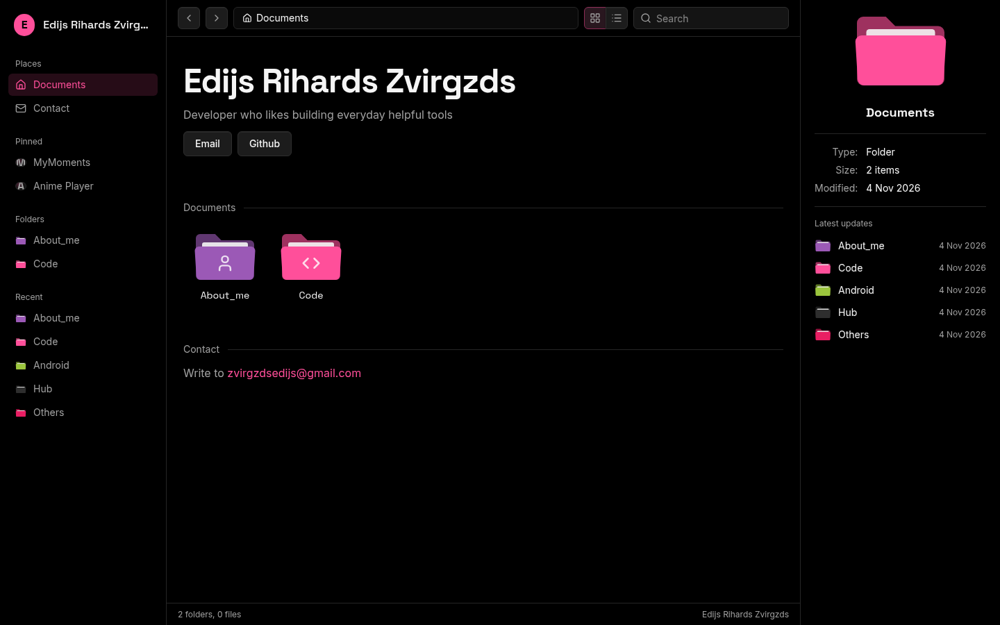
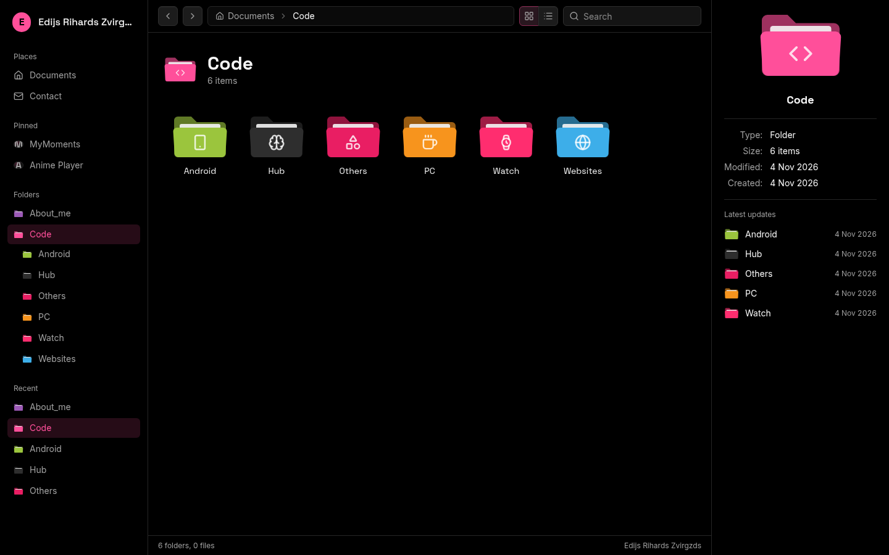
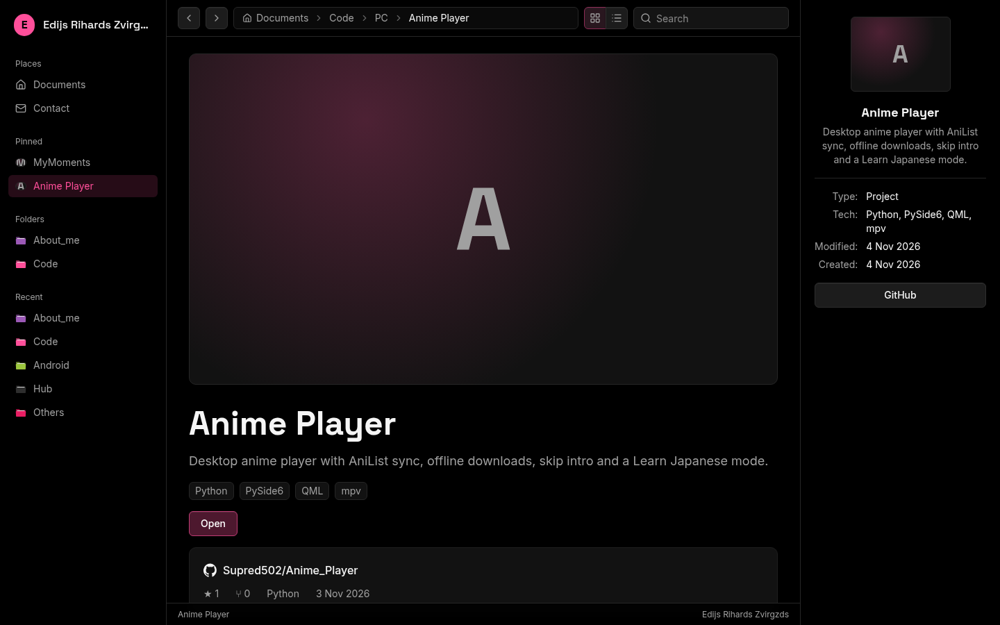

<p align="center">
  
</p>

<h1 align="center">Edijs Zvirgzds</h1>

<p align="center">
  My portfolio, built to look and work like a desktop file manager: projects live in
  coloured folders you can open, peek into and search.
</p>

<p align="center">
  <a href="https://edijszvirgzds.com"><b>Open the site</b></a>
  ·
  <a href="#run-it-yourself">Run it yourself</a>
  ·
  <a href="https://github.com/Supred502/EdijsZvirgzds/issues/new">Report a problem</a>
</p>

<p align="center">
  
</p>

## Features

**Browsing**
- Folders inside folders, each with its own colour and icon, starting from Documents
- Hover a folder to see what's inside in a pop-up; click anything in it to open it
- Single click shows details in the side panel, double click opens
- Icons or details view, back/forward, clickable path bar and search
- Sidebar with Places, Pinned projects, the folder tree and recently changed folders

**Projects**
- Project pages with cover, gallery, Markdown write-up and links
- Live GitHub info: stars, language, last push and the repo's top-level files
- Locked folders and projects: visible with a lock, contents stay private

**Admin**
- Login with password plus an authenticator app (2FA)
- Add and edit projects, folders and Markdown documents with a live preview
- Import a project's name and details from a GitHub link
- Drag to reorder, publish/draft and feature toggles, image uploads

**Everywhere**
- Works on phones, with a slide-out menu
- Share previews, sitemap and a custom 404 page

## Screenshots

| | |
|---|---|
|  |  |

## Run it yourself

You need [Node.js](https://nodejs.org) 22 or newer and a free [Supabase](https://supabase.com) project.

1. In Supabase, create your user under **Authentication → Users**, copy its UID, then turn off new sign-ups.
2. Open **SQL Editor** and run these files from `supabase/` in order: `schema.sql` (put your UID in place
   of the all-zeros one first), `002_folders.sql`, `003_fixes.sql`, `004_hardening.sql`.
   `seed.sql` adds optional sample projects.
3. Copy `.env.example` to `.env.local` and fill in your Supabase URL and publishable key.
   `GITHUB_TOKEN` (a read-only token for public repos) is optional and raises GitHub's rate limit.
4. Start it:

   ```bash
   npm install
   npm run dev
   ```

   Open http://localhost:3000, and http://localhost:3000/admin to log in and set up 2FA.

To put it online, import the repo into [Vercel](https://vercel.com) and add the same environment variables.

## Tests

```bash
npm test        # input validation and folder-tree logic
npm run lint
npm run build
```

## Built with

Next.js 16 (App Router), React 19, Tailwind CSS 4, Motion, Supabase (Postgres with row-level security, Auth, Storage), deployed on Vercel.

## License

[MIT](LICENSE). The site's own content (text, photos, project write-ups) lives in the database and isn't part of this repo.
